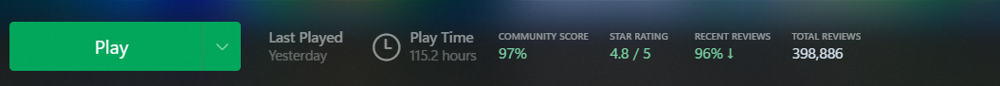

# ReviewLens

Steam reviews, at a glance.

Displays Steam community scores, star ratings, recent review trends and review counts in your library.

A minimal [Millennium](https://steambrew.app/) plugin powered by Valve's public Steam data.

**v1.5.10** · **Windows** · **Steam API only** · **No API key**

[Download .star](./reviewlens-1.5.10.star) · [Project website](./docs/) · [Report an issue](../../issues)

## Four metrics, one compact row

| Metric | What it means |
|---|---|
| **Community Score** | Percentage of positive Steam user reviews overall |
| **Star Rating** | A 5-star equivalent calculated from the community score, not a separate personal rating |
| **Recent Reviews** | Percentage of positive Steam reviews in the recent window, plus the direction against the lifetime score |
| **Total Reviews** | Number of Steam user reviews included in the overall score |

ReviewLens automatically detects the selected game. No game-by-game configuration is required. It caches data and refreshes on a five-minute interval when supported.

## Installation

1. Install [Millennium](https://steambrew.app/) for the desktop Steam client.
2. Download [`reviewlens-1.5.10.star`](./reviewlens-1.5.10.star).
3. Install the `.star` package through Millennium.
4. Enable **ReviewLens**, then fully restart Steam.
5. Select a game in your Library to see its review metrics.

## Privacy and data

ReviewLens requests public data from Valve's Steam services. It does not require an API key, subscription, account sign-in, third-party callback endpoint, or user tracking. A score may be unavailable for games without supported review data.

## Build from source

The repository contains Millennium/Starlight frontend and Lua backend source, plus the offline packaging utilities used for the distributed build. Run `build-windows.bat` on Windows with the prerequisites configured, or use your normal Starlight build environment.

## Compatibility

- Developed for the desktop Steam client with Millennium.
- Layout and APIs may change with Steam/Millennium updates.
- The provided release was tested by the creator in Steam; compatibility on other setups is not guaranteed.

## Project

Created by Ticksy. ReviewLens is an independent community plugin, not affiliated with Valve or Steam.

Please report bugs and include your Millennium version, Steam client version, and a screenshot or console error when possible.
